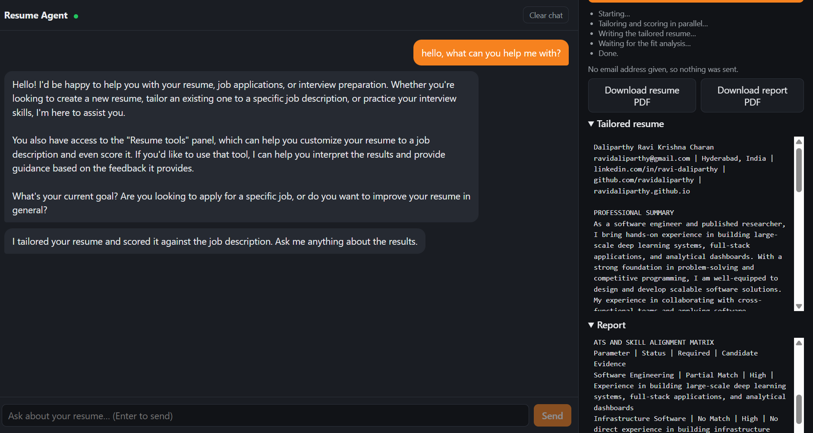
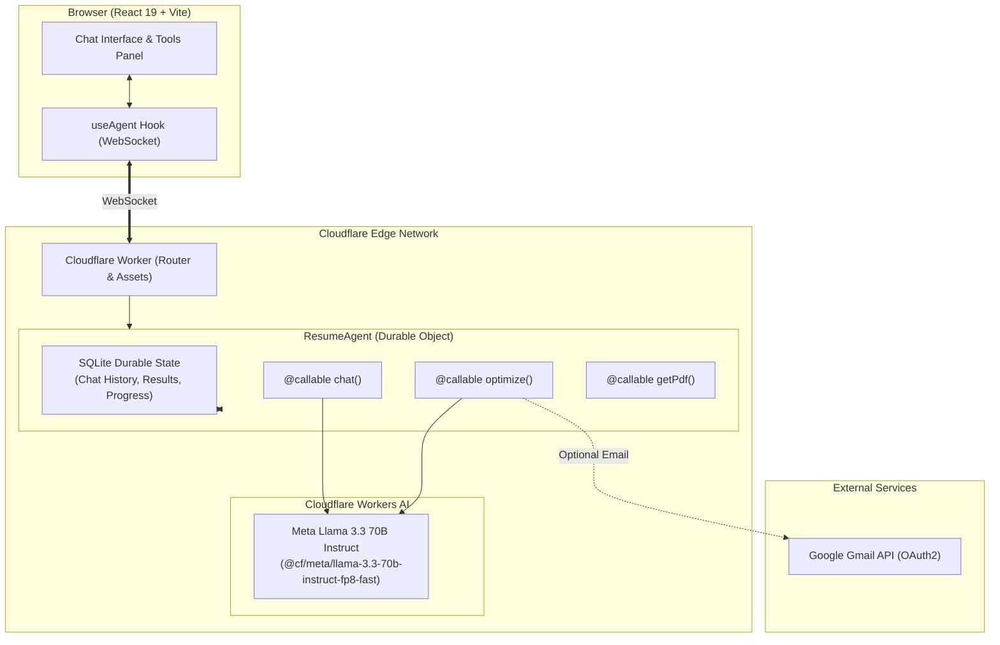
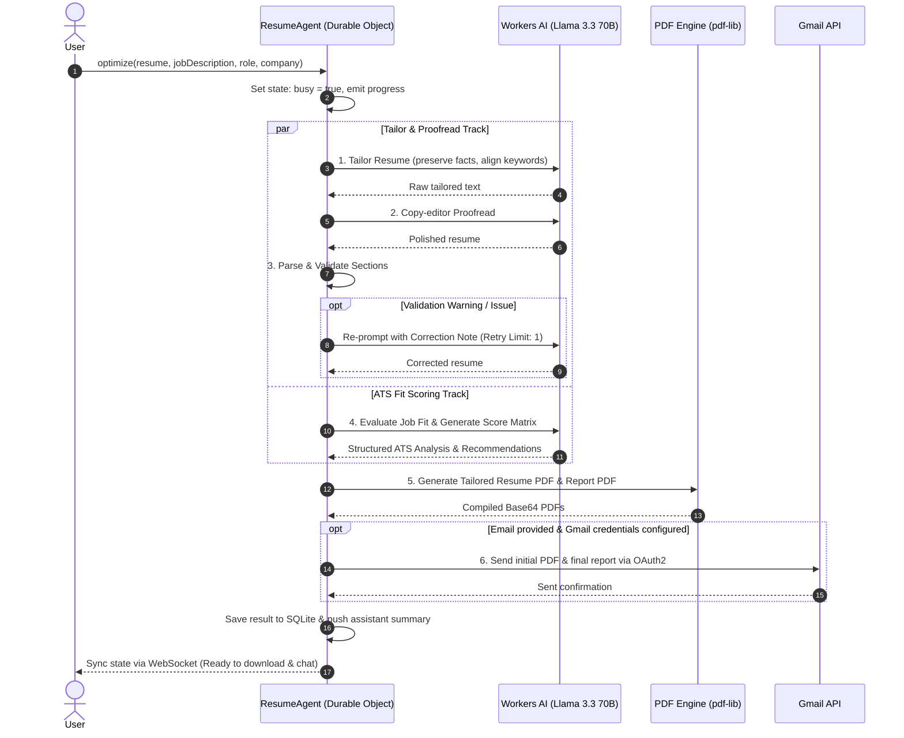

# 🚀 Resume Agent (Cloudflare Agents SDK & Workers AI)

[](https://resume-agent.ravidaliparthy.workers.dev)
[](https://workers.cloudflare.com/)
[](https://github.com/cloudflare/agents)
[](https://developers.cloudflare.com/workers-ai/)
[](https://react.dev/)
[](https://www.typescriptlang.org/)

An enterprise-grade, edge-native **AI Career Assistant and Resume Optimization Pipeline** built on **Cloudflare Workers**, **Cloudflare Agents SDK**, and **Workers AI (Meta Llama 3.3 70B)**. 

Resume Agent seamlessly combines interactive conversational coaching with an autonomous multi-stage resume tailoring, proofreading, ATS scoring, and PDF generation workflow.

🌐 **Try the Live Application:** [https://resume-agent.ravidaliparthy.workers.dev](https://resume-agent.ravidaliparthy.workers.dev)

---

## 📸 Interface Preview



---

## ✨ Key Features

- **🧠 Real-Time Conversational AI Coach**
  - Chat directly with an AI career advisor powered by Meta Llama 3.3 70B.
  - Context-aware: instantly analyzes and discusses tailored resumes, scoring reports, and interview preparation strategies.
  - Strict anti-hallucination guardrails: never invents employment, metrics, or technologies not present in the original resume.

- **⚡ Multi-Stage Autonomous Pipeline**
  - **Resume Tailoring**: Restructures and emphasizes relevant achievements for a specific role and company.
  - **Meticulous Copy-Editing**: Proofreads for grammar, flow, action verbs, and readability without mutating candidate facts.
  - **Quality Gate & Auto-Correction**: Validates section headers, syntax, and formatting with an automatic retry correction loop.
  - **ATS & Fit Evaluation**: Evaluates skill alignment, match percentage, critical gaps, and high-impact keyword opportunities in parallel.

- **💾 Persistent Edge State (Durable Objects + SQLite)**
  - Backed by Cloudflare Durable Objects with integrated SQLite persistence.
  - Each session maintains chat logs, progress status, and generated outputs across browser refreshes, reconnects, and edge redeployments.
  - Real-time bi-directional synchronization over WebSockets via `useAgent`.

- **📄 Dynamic PDF Generation**
  - Programmatically generates submission-ready PDFs right on the edge using `pdf-lib`.
  - Export tailored resumes and ATS evaluation reports directly from the browser.

- **📬 Automated Email Delivery (Optional)**
  - Built-in integration with Google Gmail API (OAuth2).
  - Automatically dispatches tailored resume PDFs and scoring summaries directly to candidate inboxes.

---

## 🏛️ System Architecture



---

## 🔄 Resume Optimization Lifecycle

When you trigger the **Tailor + Score** workflow, the agent coordinates parallel tasks:



---

## 🛠️ Tech Stack & Implementation Details

| Layer | Component | Description |
|---|---|---|
| **Frontend** | React 19, TypeScript, Vite | Modern single-page app with dual chat and tool panels |
| **Edge Framework** | Cloudflare Workers & Assets | Full-stack serverless deployment running globally on Cloudflare |
| **Agent Orchestration**| `@cloudflare/agents` SDK | State synchronization, RPC callables, and WebSocket connection |
| **Durable State** | Cloudflare Durable Objects | Per-session stateful SQLite storage surviving redeploys |
| **AI Model** | Meta Llama 3.3 70B Instruct | `@cf/meta/llama-3.3-70b-instruct-fp8-fast` on Workers AI |
| **Document Generation**| `pdf-lib` | Standardized, print-friendly PDF generation for resumes & reports |
| **Email Service** | Google Gmail API | Secure email delivery using OAuth2 refresh tokens |

---

## 📂 Project Structure

```text
├── .dev.vars.example       # Example secrets template for local dev
├── .gitignore              # Git ignore rules for node, dist, wrangler & secrets
├── index.html              # HTML entrypoint for the Single Page App
├── package.json            # Node dependencies and project scripts
├── tsconfig.json           # TypeScript configuration
├── vite.config.ts          # Vite configuration with @cloudflare/vite-plugin
├── wrangler.jsonc          # Cloudflare Worker, Durable Objects & AI config
│
└── src/
    ├── client.tsx          # React application UI (chat, resume panel, PDF download)
    ├── styles.css          # Modern dark-mode styling with glassmorphism touches
    ├── server.ts           # ResumeAgent class, RPC callables, and DO state handlers
    ├── pipeline.ts         # LLM calls, parallel orchestration, PDF export & Gmail
    └── prompts.ts          # Persona prompts, ATS rubrics & validation rules
```

---

## 🚀 Getting Started

### Prerequisites

- [Node.js](https://nodejs.org/) (v18.0.0 or higher)
- [Cloudflare Account](https://dash.cloudflare.com/) (Free tier works!)
- [Wrangler CLI](https://developers.cloudflare.com/workers/wrangler/) (included in `devDependencies`)

### 1. Clone & Install

```bash
git clone https://github.com/your-username/resume-agent.git
cd resume-agent
npm install
```

### 2. Authenticate Cloudflare Wrangler

Because the application uses Cloudflare Workers AI bindings, authenticate your local environment with your Cloudflare account:

```bash
npx wrangler login
```

### 3. Run Locally

Start the Vite development server with the Cloudflare Workers runtime:

```bash
npm run dev
```

Visit `http://localhost:5173` in your browser.

---

## 🔑 Optional: Configuring Gmail Delivery

If you want the agent to automatically email generated PDFs to users:

1. Create a Google Cloud project with the **Gmail API** enabled.
2. Configure an OAuth 2.0 Client ID with the scope `https://www.googleapis.com/auth/gmail.send`.
3. Generate a refresh token (e.g., via [Google OAuth 2.0 Playground](https://developers.google.com/oauthplayground)).
4. Configure secrets locally:
   ```bash
   cp .dev.vars.example .dev.vars
   ```
   Add your credentials to `.dev.vars`:
   ```ini
   GMAIL_CLIENT_ID=your_client_id.apps.googleusercontent.com
   GMAIL_CLIENT_SECRET=your_client_secret
   GMAIL_REFRESH_TOKEN=your_refresh_token
   GMAIL_SENDER=your-email@gmail.com
   ```
5. Configure secrets in production:
   ```bash
   npx wrangler secret put GMAIL_CLIENT_ID
   npx wrangler secret put GMAIL_CLIENT_SECRET
   npx wrangler secret put GMAIL_REFRESH_TOKEN
   npx wrangler secret put GMAIL_SENDER
   ```

*(Note: If Gmail secrets are omitted, the application will simply skip email dispatch, and users can still download their PDFs directly in the browser.)*

---

## 🚢 Deployment

Deploy directly to Cloudflare Workers with a single command:

```bash
npm run deploy
```

This compiles the client via Vite, builds the Worker bundle, and deploys the Durable Objects and static assets to Cloudflare's global edge network.

---

## 🔒 Safety & Content Integrity Guardrails

- **Zero Fabrication**: The agent strictly forbids generating false metrics, employers, job titles, or skills.
- **Truth Preservation**: Every publication, project, degree, and certification in the source resume is preserved.
- **Tone Standardization**: Enforces professional 3rd-person implied grammar, omitting personal pronouns ("I", "me", "my").
- **Durable Isolation**: Each user session is scoped to an isolated Durable Object instance with private SQLite storage.

---

## 📄 License

This project is licensed under the [MIT License](LICENSE).
